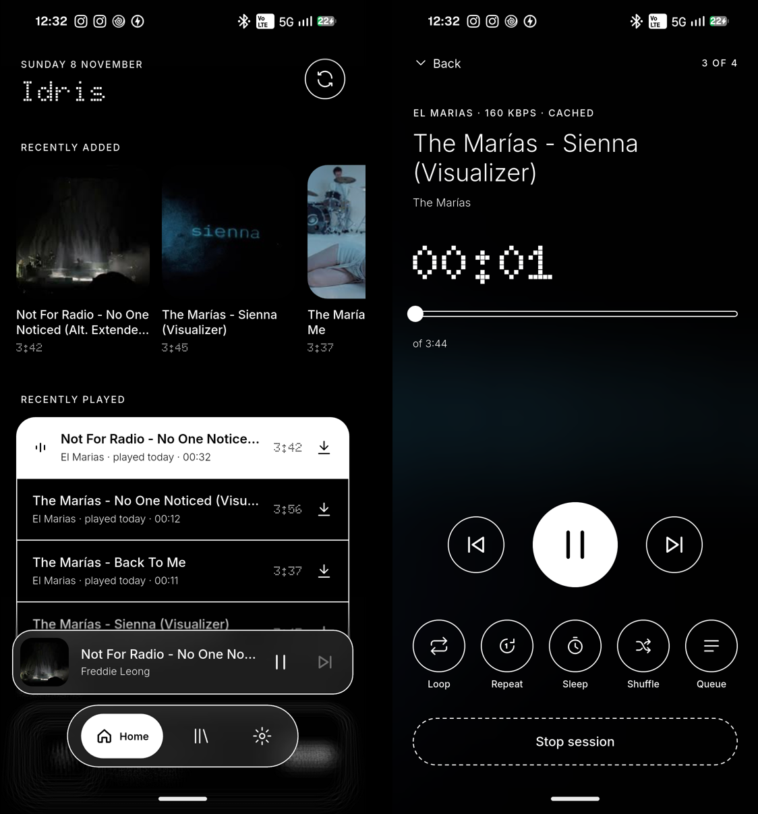
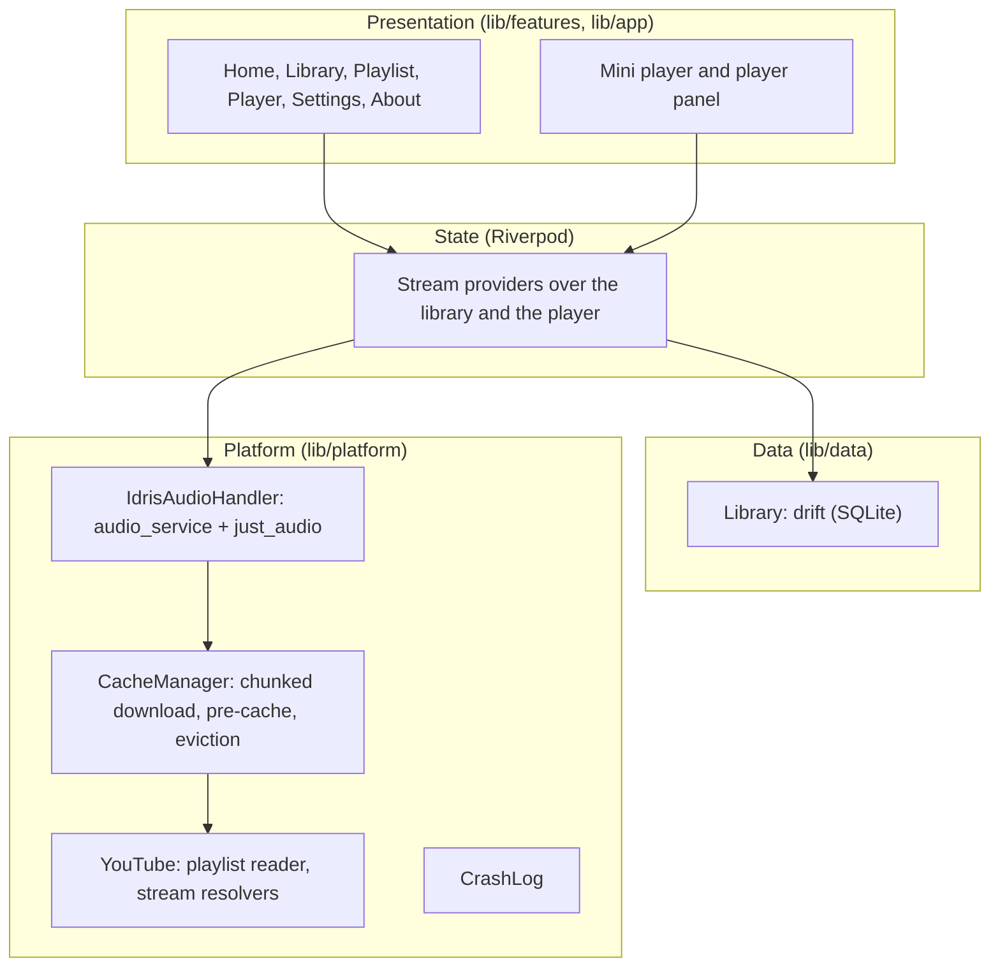

<div align="center">


# Idris

**Your mantras and calm music, from your own YouTube playlists — and nothing else.**


</div>

<p align="center">
  
</p>

---

## Why Idris

YouTube is where the chants, mantras and calm music live, but opening YouTube means recommendations, Shorts and comments. Idris plays **only the playlists you give it**, as audio, in a quiet black-and-white app.

Paste a playlist link once. Idris keeps it in sync, and every track it plays is kept on the phone, so the next play starts instantly and works without a network.

### Principles

| Principle | What it means in practice |
| --- | --- |
| **Only your playlists** | No search, no feed, no suggestions. Idris plays the videos in the playlists you import, as audio. |
| **No buffering the second time** | One download both plays a track and caches it. Played tracks are on the phone for good, until the cache needs the room. |
| **Offline and private** | No account and no sign-in. Nothing is collected or sent anywhere but YouTube. |
| **Calm** | Veronica's design language: pure black and white, dot-matrix type, 1 px ink outlines, glass. Artwork is an experimental, optional exception. |

Idris is a personal, sideloaded app, not distributed through the Play Store.

## Features

| Area | What it does |
| --- | --- |
| **Playlists** | Paste a public or unlisted playlist link (no sign-in). Re-synced when the app opens and on pull to refresh: new videos show under *Recently added*, removed ones drop out. A rename in Idris survives syncs. |
| **Home** | Recently added, recently played and your playlists. |
| **Player** | Full screen, growing out of the mini player and shrinking back into it with a swipe down. Loop (off, playlist, one track), repeat a track ×N (3 to 1008, then stop or next), sleep timer (15 to 60 min, custom or end of track, fading out), shuffle and a reorderable queue. |
| **Mini player** | Docked above the tab bar and on playlist pages, as in Spotify and Apple Music. |
| **Media controls** | Background playback with the notification, lock screen, quick-settings player and headset buttons. |
| **Quality** | Best (default), High (~160 kbps), Medium (~128 kbps) or Low. |
| **Cache** | Every played track is kept. *Pin offline* (a playlist or a track) downloads ahead, on Wi-Fi by default, and is never removed. Unpinned audio past the limit (1, 2, 5 or 10 GB, or none) goes least recently played first. |
| **Artwork** | Experimental, on by default: YouTube thumbnails in the mini player and on Home, blurred behind the player. Saved with the audio, so they show offline. |
| **Crash reports** | An unexpected error shows a calm popup with the log, *Copy log* and *Save to Downloads*. A crash on the Android side is shown on the next launch. |
| **Glyph** | Optional, on Nothing phones: a slow breathing pulse on the strip while audio plays. |

---

## Architecture

Idris is a Flutter app (Cupertino widgets only, no Material) with a thin native Kotlin layer for NewPipe's extractor and crash files.



**How a track plays.**

```
track ──► CacheManager.open
            ├─ complete file in <appSupport>/audio ──► AudioSource.file   (no network)
            └─ else resolve a stream (quality-aware), in order, using the
               first whose link YouTube actually serves:
                 NewPipe Extractor (YouTubeChannel.kt)
                 youtube_explode: androidVr → androidSdkless → tv → safari
               ──► CacheDownload: 1 MB range requests (YouTube refuses more)
                   into <id>.<ext>.part
               ──► CachingAudioSource (just_audio StreamAudioSource) reads the
                   .part file as it fills; a seek past the download reads that
                   range from the network directly
               ──► on completion: rename to <id>.<ext>, mark complete, evict
```

If a stream breaks mid-play, the next resolver is tried and playback resumes at the same second. The `.part` file is resumed, not restarted. All YouTube traffic leaves by one network route (IPv6 when the phone has a public address, else IPv4), because stream links are signed for the address that asked for them.

**Playlists.** YouTube's current playlist pages list videos as `lockupViewModel` items, which youtube_explode doesn't read yet, so `PlaylistScraper` reads them (and the older format), following continuation pages.

### Enforced rules

Checked by tests on every run:

- **Two colours.** Colours may only be created in `lib/core/theme/v_colors.dart`, and importing Material fails the build.
- **Playback rules:** loop, repeat counts and the sleep timer's *end of track*.
- **Caching:** range-chunked downloads, reading while downloading, far seeks, resuming, eviction order (pinned never evicted).
- **Library sync:** added and removed videos, renames kept, pinned sets, export round-trip.
- **Playlist reading** in YouTube's current and older formats.

---

## Project structure

| Path | What |
| --- | --- |
| `lib/core/` | Veronica's design system: theme tokens, widgets, icons, progressive-blur shader |
| `lib/data/` | drift database, `Library` repository, models, Riverpod providers |
| `lib/platform/youtube.dart` | playlist fetch, stream resolvers |
| `lib/platform/playlist_scraper.dart` | reads playlist pages (YouTube's current format) |
| `lib/platform/net.dart` | one IPv6/IPv4 route for all YouTube traffic |
| `lib/platform/quality.dart` | quality setting and stream choice (mirrored in `YouTubeChannel.kt`) |
| `lib/platform/cache_download.dart` | chunked download + streaming source |
| `lib/platform/cache_manager.dart` | cache index, artwork, pre-cache worker, eviction |
| `lib/platform/audio_handler.dart` | media service, queue, loop, repeat, sleep, recovery |
| `lib/platform/playback_rules.dart` | what follows a finished track; shuffle |
| `lib/platform/crash_log.dart` | rolling log, error hooks, crash reports |
| `lib/features/` | Home, Library, Playlist, Player (panel, sheets, mini player), Settings, About, Onboarding |
| `android/app/src/main/kotlin/` | `YouTubeChannel` (NewPipe), `CrashFiles` (native crashes, Downloads) |
| `tool/live_playlist_test.dart` | a by-hand check against real YouTube playlists |

---

## Getting started

### Requirements

- Flutter 3.47 or later (Dart 3.13)
- Android SDK 36 and JDK 17
- Any recent Android phone; a Nothing phone for the Glyph pulse

### Build and run

```sh
flutter pub get
dart run build_runner build        # drift code generation
flutter analyze
flutter test
flutter run                        # with the phone connected over USB debugging
```

### Signed releases

Release APKs are signed with a key that never enters the repository.

- **Locally:** copy `.env.example` to `.env`, which is gitignored. Put the keystore in it as base64 (`base64 -w0 release-key.jks`) along with its passwords, then run `./build_signed.sh`. The keystore is decoded to a temporary file for the build and deleted afterwards.
- **On GitHub:** every push to `main` runs `.github/workflows/release.yml`. It builds, tests and signs the APKs and publishes them as a release. Set `IDRIS_KEYSTORE_BASE64`, `IDRIS_KEYSTORE_PASSWORD`, `IDRIS_KEY_PASSWORD` and, optionally, `IDRIS_KEY_ALIAS` as secrets in a `deployment` environment.

Without these settings, release builds fall back to the debug key.

### Glyph (optional)

On Nothing phones, the breathing pulse may need Glyph debug mode, which switches itself off after 48 hours:

```sh
adb shell settings put global nt_glyph_interface_debug_enable 1
```

### Installing a release

Signed APKs are attached to every [release](https://github.com/isg32/idris/releases). For most phones, use `app-arm64-v8a-release.apk`. Everything Idris keeps stays on the phone.

---

## Development

- **Commits.** History is linear on `main`; each commit is one change with a message that says why, and passes `flutter analyze` and `flutter test`.
- **Live check.** `flutter test tool/live_playlist_test.dart --dart-define=PLAYLISTS=<id>,<id>` reads real playlists, for when YouTube changes its pages.
- **App icon.** Sources are in `assets/icon/`. Run `dart run flutter_launcher_icons` after changing them.
- **Design.** The screens were designed on the "Idris screens" canvas in Claude Design, in Veronica's design language.

---

## License

Copyright (C) 2026 Sapan Gajjar

Idris is free software: you can redistribute it and/or modify it under the terms of the [GNU General Public License v3.0](LICENSE) as published by the Free Software Foundation. It is distributed in the hope that it will be useful, but WITHOUT ANY WARRANTY; without even the implied warranty of MERCHANTABILITY or FITNESS FOR A PARTICULAR PURPOSE. See the [LICENSE](LICENSE) for details.

Bundled third-party code and assets keep their own licences: NewPipe Extractor (GPL-3.0), and Doto and Inter under the SIL Open Font License ([`assets/fonts/`](assets/fonts/)).
