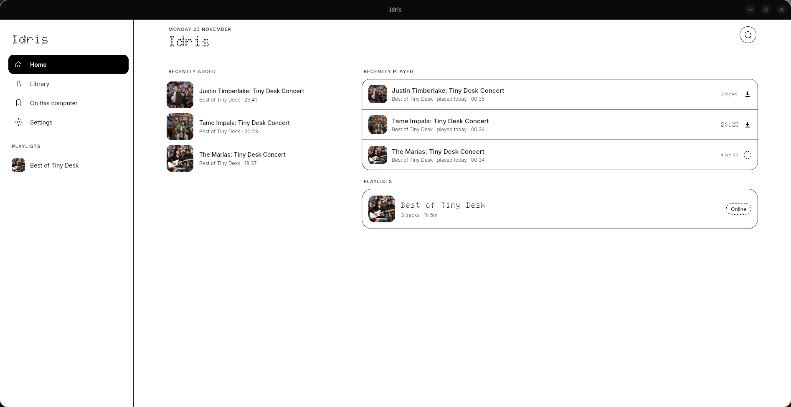
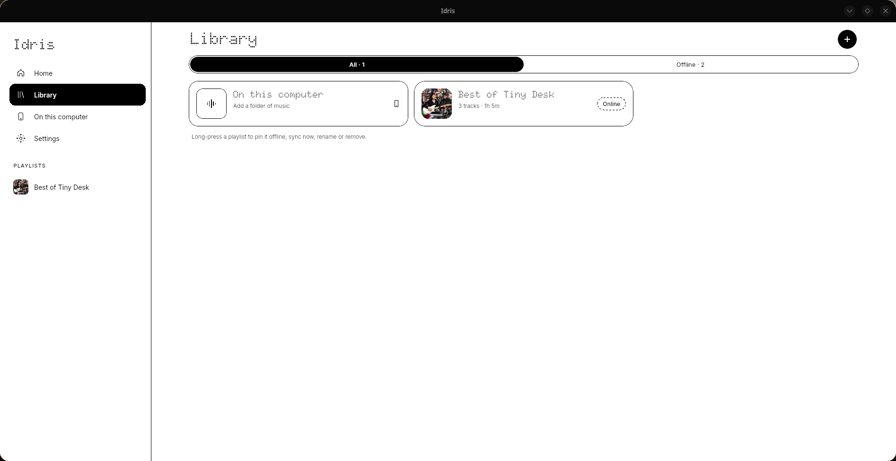
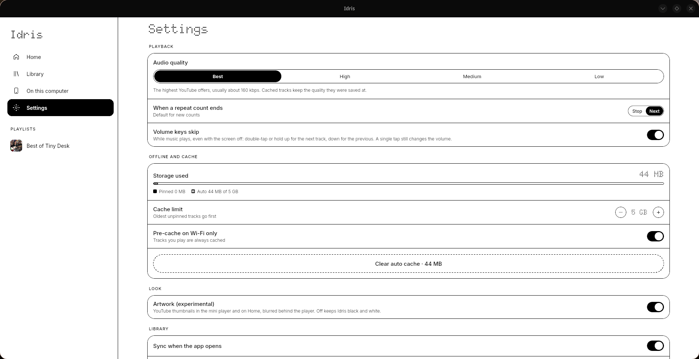
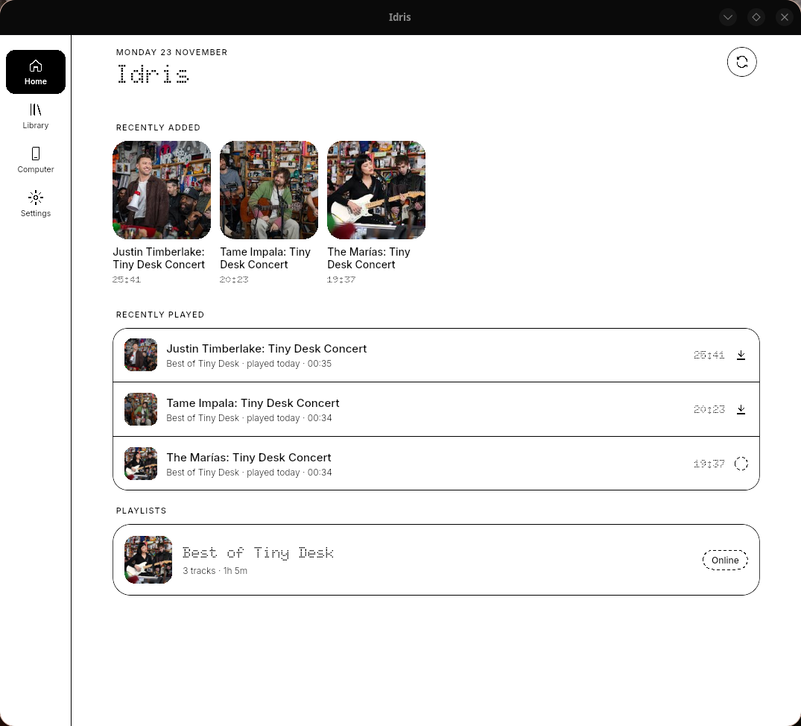
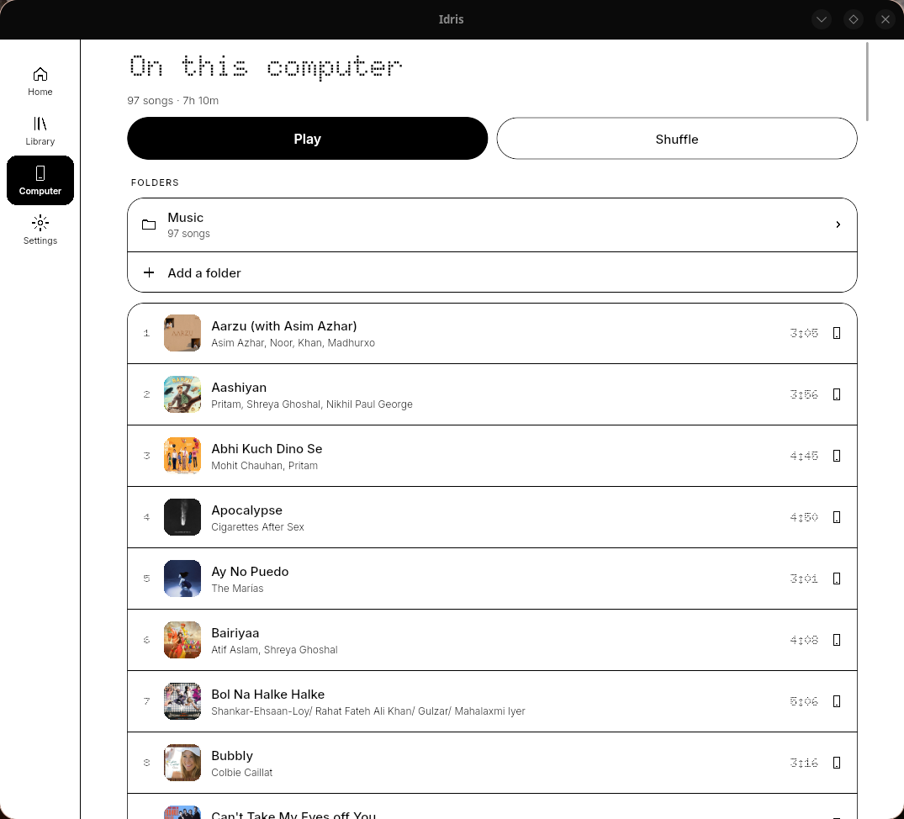
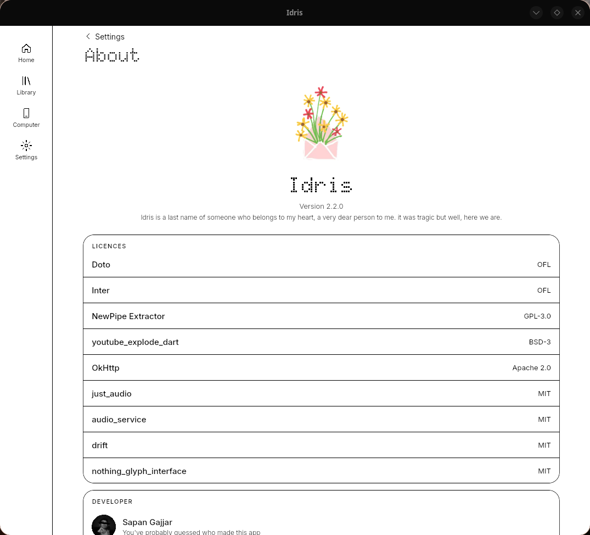
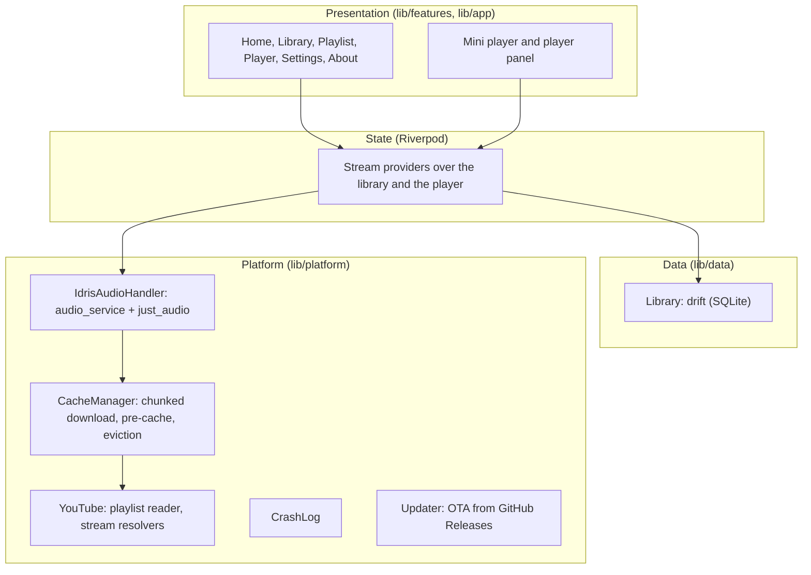

<div align="center">


# Idris

**Your mantras and calm music, from your own YouTube playlists — and nothing else.**


</div>

<p align="center">
  
</p>

---

## Why Idris

> Idris is a last name of someone who belongs to my heart, a very dear person to me. it was tragic but well, here we are.

YouTube is where the chants, mantras and calm music live, but opening YouTube means recommendations, Shorts and comments. Idris plays **only the playlists you give it**, as audio, in a quiet black-and-white app.

Paste a playlist link once. Idris keeps it in sync, and every track it plays is kept on the phone, so the next play starts instantly and works without a network.

### Principles

| Principle | What it means in practice |
| --- | --- |
| **Only your playlists** | No search, no feed, no suggestions. Idris plays the videos in the playlists you import, as audio. |
| **No buffering the second time** | One download both plays a track and caches it. Played tracks are on the phone for good, until the cache needs the room. |
| **Offline and private** | No account and no sign-in. Nothing is collected or sent anywhere but YouTube, and LRCLIB for lyrics (only a song's title, artist and length). |
| **Calm** | Veronica's design language: pure black and white, dot-matrix type, 1 px ink outlines, glass. Artwork is an experimental, optional exception. |

Idris is a personal, sideloaded app, not distributed through the Play Store.

## Features

| Area | What it does |
| --- | --- |
| **Playlists** | Paste a public or unlisted playlist link (no sign-in). Re-synced when the app opens and on pull to refresh: new videos show under *Recently added*, removed ones drop out. A rename in Idris survives syncs. |
| **On this phone** | Music from folders you choose on the phone, in one list at the top of Library: titles, artists and covers read from the files, played straight from them (never cached, no network). Pull down to pick up new files; removing a folder only takes it out of Idris. Uses Android's folder picker, so no storage permission. |
| **Home** | Recently added, recently played and your playlists. |
| **Player** | Full screen, growing out of the mini player and shrinking back into it with a swipe down. Loop (off, playlist, one track), repeat a track ×N (3 to 1008, then stop or next), sleep timer (15 to 60 min, custom or end of track, fading out), shuffle and a reorderable queue. |
| **Lyrics** | Synced lyrics that follow the song (the line being sung in ink, the rest faded; tap a line to go there), or plain ones, from [LRCLIB](https://lrclib.net) (free and open, no account) or an `.lrc` file beside a local song. Looked up as each song starts and kept with it, so they're there offline and never looked up twice; a song with none is tried again after a week. In the player: a Lyrics button on a phone, beside the controls on a desktop. YouTube titles are tidied into artist and title first ("Mosquito (Official Video)" is "Mosquito"); when unsure, Idris shows none rather than another song's words. |
| **Mini player** | Docked above the tab bar and on playlist pages, as in Spotify and Apple Music. |
| **Volume keys** | While music plays, even with the screen off or another app in front: double-tap or hold Volume up for the next track, Volume down for the previous; a single tap still changes the volume. Off in Settings › Playback. |
| **Media controls** | Background playback with the notification, lock screen, quick-settings player and headset buttons. |
| **Quality** | Best (default), High (~160 kbps), Medium (~128 kbps) or Low. |
| **Cache** | Every played track is kept. *Pin offline* (a playlist or a track) downloads ahead, on Wi-Fi by default, and is never removed. Unpinned audio past the limit (1, 2, 5 or 10 GB, or none) goes least recently played first. To free space yourself: *Remove from cache* on a track, *Remove downloads* on a playlist (which also stops keeping it offline), or *Clear auto cache* in Settings. |
| **Covers** | Every track shows its YouTube picture, cropped square, in lists, on Home and in the mini player, and blurred behind the player (Settings › Artwork, on by default). A playlist's cover is a mosaic of its first four tracks. Long-press a track or playlist (or tap a playlist's cover) to choose a picture from the phone instead; it's copied into Idris. All saved on the phone, so they show offline. |
| **Crash reports** | An unexpected error shows a calm popup with the log, *Copy log* and *Save to Downloads*. A crash on the Android side is shown on the next launch. |
| **Updates** | Idris updates itself from GitHub Releases: it checks at launch and every 6 hours (or from *Settings › Check for updates*), shows a card on Home and in Settings, downloads with progress (resuming after a drop), checks the size, SHA-256 and signer, and installs through Android's PackageInstaller. After the first update, Android installs the next ones without its confirm screen. *What's new* shows once afterwards. |
| **Linux** | The same app on a Linux desktop, from the same code: YouTube streams found by the same NewPipe extractor (a small Java helper), audio through libmpv, and "On this computer" for folders of music on disk. |
| **Layouts** | Three, by window size: mobile (tab bar and mini player), tablet (a rail of sections, also a phone on its side, where the player puts its controls and the lyrics or cover side by side) and desktop (a sidebar with the playlists, pages in columns, a now-playing bar). |
| **Glyph** | Optional, on Nothing phones: a slow breathing pulse on the strip while audio plays. |

### On a desktop

The Linux app, in its desktop layout (a window 1100 px and wider): the sidebar with the sections and your playlists, and pages in columns.

<p align="center">
  
</p>

<table>
  <tr>
    <td width="50%"></td>
    <td width="50%"></td>
  </tr>
</table>

Narrower, the tablet layout: a rail of sections instead of the sidebar.

<table>
  <tr>
    <td width="33%"></td>
    <td width="33%"></td>
    <td width="33%"></td>
  </tr>
</table>

---

## Architecture

Idris is a Flutter app (Cupertino widgets only, no Material) for Android and Linux. On Android a thin native Kotlin layer runs NewPipe's extractor, the folder picker, the updater and crash files; on Linux NewPipe's extractor runs as a small Java helper (`linux/extractor`) and audio plays through libmpv.



**How a track plays.**

```
track ──► CacheManager.open
            ├─ complete file in <appSupport>/audio ──► AudioSource.file   (no network)
            └─ else resolve a stream (quality-aware), in order, using the
               first whose link YouTube actually serves:
                 NewPipe Extractor (YouTubeChannel.kt)
                 youtube_explode: androidVr → androidSdkless → tv → safari
               ──► CacheDownload: 1 MB range requests (YouTube refuses more)
                   into <id>.<ext>.part
               ──► CachingAudioSource (just_audio StreamAudioSource) reads the
                   .part file as it fills; a seek past the download reads that
                   range from the network directly
               ──► on completion: rename to <id>.<ext>, mark complete, evict
```

If a stream breaks mid-play, the next resolver is tried and playback resumes at the same second. The `.part` file is resumed, not restarted. All YouTube traffic leaves by one network route (IPv6 when the phone has a public address, else IPv4), because stream links are signed for the address that asked for them.

**Playlists.** YouTube's current playlist pages list videos as `lockupViewModel` items, which youtube_explode doesn't read yet, so `PlaylistScraper` reads them (and the older format), following continuation pages.

### Enforced rules

Checked by tests on every run:

- **Two colours.** Colours may only be created in `lib/core/theme/v_colors.dart`, and importing Material fails the build.
- **Playback rules:** loop, repeat counts and the sleep timer's *end of track*.
- **Caching:** range-chunked downloads, reading while downloading, far seeks, resuming, eviction order (pinned never evicted).
- **Library sync:** added and removed videos, renames kept, pinned sets, export round-trip.
- **Playlist reading** in YouTube's current and older formats.
- **Updates:** finding, downloading, resuming, rejecting a damaged or differently signed APK, the install permission, the 6-hour check, *What's new* once; and the version in About matching `pubspec.yaml`.

---

## Project structure

| Path | What |
| --- | --- |
| `lib/core/` | Veronica's design system: theme tokens, widgets, icons, progressive-blur shader |
| `lib/data/` | drift database, `Library` repository, models, Riverpod providers |
| `lib/platform/youtube.dart` | playlist fetch, stream resolvers |
| `lib/platform/playlist_scraper.dart` | reads playlist pages (YouTube's current format) |
| `lib/platform/net.dart` | one IPv6/IPv4 route for all YouTube traffic |
| `lib/platform/quality.dart` | quality setting and stream choice (mirrored in `YouTubeChannel.kt`) |
| `lib/platform/cache_download.dart` | chunked download + streaming source |
| `lib/platform/cache_manager.dart` | cache index, artwork, pre-cache worker, eviction |
| `lib/platform/audio_handler.dart` | media service, queue, loop, repeat, sleep, recovery |
| `lib/platform/playback_rules.dart` | what follows a finished track; shuffle |
| `lib/platform/volume_keys.dart` | tells a volume-key tap from a hold |
| `lib/platform/crash_log.dart` | rolling log, error hooks, crash reports |
| `lib/platform/covers.dart` | covers the user chose, copied into the app |
| `lib/platform/local_music.dart` | "On this phone": chosen folders, scanning, `local:` tracks (with `LocalMusic.kt`) |
| `lib/platform/updater.dart` | over-the-air updates: check, download, verify, install (with `updater_channel.dart`) |
| `lib/features/` | Home, Library, Playlist, Player (panel, sheets, mini player), Settings, About, Onboarding |
| `android/app/src/main/kotlin/` | `YouTubeChannel` (NewPipe), `CrashFiles` (native crashes, Downloads), `Updater` (PackageInstaller), `LocalMusic` (folder picker, tags, embedded art) |
| `lib/core/layout.dart`, `lib/app/desktop.dart` | the three layouts by window size; the tablet and desktop frame (sidebar or rail, now-playing bar) |
| `lib/platform/desktop_extractor.dart`, `linux/extractor/` | NewPipe on Linux: the Java helper and how Idris talks to it |
| `linux/` | the Linux desktop runner |
| `linux/build_appimage.sh` | builds `Idris-x86_64.AppImage` (by hand and in CI) |
| `lib/platform/appimage_updater.dart` | the AppImage replacing itself in place, and restarting |
| `lib/platform/desktop_entry.dart` | the AppImage putting itself in the app menu |
| `lib/platform/lyrics.dart`, `lib/features/player/lyrics_view.dart` | lyrics: LRC, YouTube titles as songs, LRCLIB, the cache; the view in the player |
| `tool/live_playlist_test.dart` | a by-hand check against real YouTube playlists |

---

## Getting started

### Requirements

- Flutter 3.47 or later (Dart 3.13)
- Android SDK 36 and JDK 17
- Any recent Android phone; a Nothing phone for the Glyph pulse
- For Linux: GTK 3, libmpv, clang, CMake and Ninja (e.g. `gtk3 mpv clang cmake ninja` on Arch)

### Build and run

```sh
flutter pub get
dart run build_runner build        # drift code generation
flutter analyze
flutter test
flutter run                        # with the phone connected over USB debugging
```

On Linux:

```sh
./linux/extractor/gradlew -p linux/extractor installDist   # the NewPipe helper
flutter run -d linux                               # run from the repo root
```

### Signed releases

Release APKs are signed with a key that never enters the repository.

- **Locally:** copy `.env.example` to `.env`, which is gitignored. Put the keystore in it as base64 (`base64 -w0 release-key.jks`) along with its passwords, then run `./build_signed.sh`. The keystore is decoded to a temporary file for the build and deleted afterwards.
- **On GitHub:** every push to `main` runs `.github/workflows/release.yml`. It builds, tests and signs the APKs and publishes them as a release, with an `update.json` that installed copies read to update themselves. Set `IDRIS_KEYSTORE_BASE64`, `IDRIS_KEYSTORE_PASSWORD`, `IDRIS_KEY_PASSWORD` and, optionally, `IDRIS_KEY_ALIAS` as secrets in a `deployment` environment.

Without these settings, release builds fall back to the debug key.

### Over-the-air updates

**Bump the version on every push to `main`**, in `pubspec.yaml` (`version: 1.2.0+8`: name and build number) and `kAppVersion` in `lib/features/settings/about_page.dart`; `test/version_test.dart` checks they agree. `--split-per-abi` adds 1000 × the ABI to the build number (build 8 is `2008` on arm64-v8a), and CI **refuses to publish** a release whose arm64 versionCode isn't above the last one's, since no phone could install it.

Each release carries `update.json` (at `releases/latest/download/update.json`): every APK's URL, size, SHA-256 and versionCode (read from the APK with `aapt2`), and the commit subjects since the last release as *What's new*.

```
check update.json ──► newer versionCode for this ABI? ──► card on Home and in Settings
  ──► download (Range resume) ──► verify size, SHA-256, signer, versionCode
  ──► "Install unknown apps" (asked once) ──► PackageInstaller session
  ──► Idris is replaced ──► "Idris updated to X" notification, What's new on next launch
```

- Android closes the running app while it replaces it, so playback stops for the install; it's back with one tap on the notification.
- **The Linux AppImage updates itself too,** from update.json's `linux-x86_64` entry (its version is the build number, the pubspec's `+N`, kept in step with `kAppBuild` by `test/version_test.dart`). It downloads the new AppImage, checks its size and SHA-256, copies it beside the running one and renames it over it (atomic, so a failed update never leaves a broken app), then offers **Restart Idris**. A PC never takes an Android APK, whatever update.json holds. Development builds (not run as an AppImage) don't update themselves.
- An update must be signed with the same key as the installed app. A copy signed with another key (a debug build) is told to reinstall once from GitHub.
- Copies older than 1.2.0 have no updater: install 1.2.0 by hand once, and later versions come by themselves.
- To test against a local server: `flutter build apk --release --split-per-abi --target-platform android-arm64 --dart-define=IDRIS_UPDATE_URL=http://127.0.0.1:8765/update.json` and `adb reverse tcp:8765 tcp:8765`. The server must support Range requests.

### Glyph (optional)

On Nothing phones, the breathing pulse may need Glyph debug mode, which switches itself off after 48 hours:

```sh
adb shell settings put global nt_glyph_interface_debug_enable 1
```

### Installing a release

Signed APKs are attached to every [release](https://github.com/isg32/idris/releases). For most phones, use `app-arm64-v8a-release.apk`. Everything Idris keeps stays on the phone.

On Linux, use `Idris-x86_64.AppImage` from the same release: see [Linux (AppImage)](#linux-appimage).

### Linux (AppImage)

One file, for any recent x86-64 desktop Linux. It carries its own NewPipe helper (with a Java runtime trimmed to what it needs) and libmpv, and uses the desktop's own GTK, graphics and sound.

**Install**, once:

1. Download it from the latest release into a folder you can write to and where it can stay (it updates itself in place):

   ```sh
   mkdir -p ~/Applications
   curl -L -o ~/Applications/Idris-x86_64.AppImage \
     https://github.com/isg32/idris/releases/latest/download/Idris-x86_64.AppImage
   ```

2. Make it executable:

   ```sh
   chmod +x ~/Applications/Idris-x86_64.AppImage
   ```

3. Run it once. From then on it's in your app launcher (wofi, rofi, fuzzel, walker, your bar's app grid), as **Idris**:

   ```sh
   ~/Applications/Idris-x86_64.AppImage
   ```

It needs a desktop with GTK 3 and a sound server (PipeWire or PulseAudio), as any recent GNOME, KDE, Hyprland or Sway setup has. If it won't start because of FUSE, install `fuse2` (Arch) or `libfuse2` (Debian/Ubuntu), or run it with `--appimage-extract-and-run`.

**It adds itself to the app menu.** Each time it starts, it writes its launcher entry and icon (`~/.local/share/applications/com.isg32.idris.desktop`, `~/.local/share/icons/hicolor/192x192/apps/com.isg32.idris.png`), pointing at wherever the AppImage is, so app launchers (wofi, rofi, fuzzel, walker, a desktop's app grid) list Idris after its first run, and a moved AppImage is followed on the next start. An entry that's already right is left alone.

Versions before 2.3.0 don't add themselves. For one of those, add the entry by hand (2.3.0 and later keep it up to date):

```sh
mkdir -p ~/.local/share/applications
cat > ~/.local/share/applications/com.isg32.idris.desktop <<EOF
[Desktop Entry]
Type=Application
Name=Idris
Exec="$HOME/Applications/Idris-x86_64.AppImage"
Terminal=false
Categories=AudioVideo;Audio;Player;
StartupWMClass=com.isg32.idris
EOF
```

**Updates** come from the same releases as the phone's (see [Over-the-air updates](#over-the-air-updates)): a card on Home and Settings › Check for updates, then **Update**, then **Restart Idris**. The file is replaced where it is, so the launcher above keeps working.

**Where things are.** The library, cached audio, covers and the updater's notes live in `~/.local/share/com.isg32.idris/`. A crash log saved from the crash popup goes to `~/Downloads`. To uninstall, remove that folder, the AppImage, and its launcher entry and icon (the two files above).

**Build it yourself** with `linux/build_appimage.sh [output dir]`, which is what CI runs. It needs the Linux build requirements above, JDK 17 (for jlink) and libmpv (`libmpv-dev` on Debian/Ubuntu), and downloads linuxdeploy once into `build/appimage-tools`. Its launcher looks in the system's libraries first and falls back to the bundled ones, so the desktop's GTK always gets its own (a bundled older library had broken GTK on Arch).

**Try an update locally.** Build an older Idris that asks a local server, run it as if it were the installed AppImage, and serve a newer AppImage with an `update.json` (its `linux-x86_64` entry: the AppImage's URL, size, SHA-256, and its build number as `versionCode`):

```sh
# with kAppBuild and pubspec's +N lowered, so there's something newer
flutter build linux --release --dart-define=IDRIS_UPDATE_URL=http://127.0.0.1:8765/update.json
APPIMAGE=/path/to/an/old/Idris-x86_64.AppImage build/linux/x64/release/bundle/idris
```

The server must answer Range requests (Python's `http.server` doesn't). After **Restart Idris**, the file at `APPIMAGE` is the newer AppImage, running.

---

## Development

- **Commits.** History is linear on `main`; each commit is one change with a message that says why, and passes `flutter analyze` and `flutter test`.
- **Live check.** `flutter test tool/live_playlist_test.dart --dart-define=PLAYLISTS=<id>,<id>` reads real playlists, for when YouTube changes its pages.
- **App icon.** Sources are in `assets/icon/`. Run `dart run flutter_launcher_icons` after changing them.
- **Design.** The screens were designed on the "Idris screens" canvas in Claude Design, in Veronica's design language.

---

## License

Copyright (C) 2026 Sapan Gajjar

Idris is free software: you can redistribute it and/or modify it under the terms of the [GNU General Public License v3.0](LICENSE) as published by the Free Software Foundation. It is distributed in the hope that it will be useful, but WITHOUT ANY WARRANTY; without even the implied warranty of MERCHANTABILITY or FITNESS FOR A PARTICULAR PURPOSE. See the [LICENSE](LICENSE) for details.

Bundled third-party code and assets keep their own licences: NewPipe Extractor (GPL-3.0), and Doto and Inter under the SIL Open Font License ([`assets/fonts/`](assets/fonts/)).
